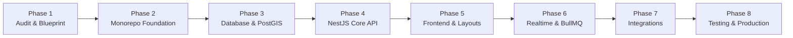

# SNEPR Platform — Refactoring Plan & Phased Execution Roadmap

**Version:** 3.0.0-Production  
**Objective:** Transform existing Snepr repository into a high-performance, modular monolith production architecture without breaking existing working functionality.

---

## Roadmap Overview

---

## Phase Breakdown

### Phase 1: Audit & Discovery (COMPLETED)
- [x] Full codebase, dependency, and database inspection.
- [x] Map existing routes, styles, and customer-to-salon workflows.
- [x] Author `docs/ARCHITECTURE_AUDIT.md`.
- [x] Author `docs/TECHNICAL_DECISIONS.md`.
- [x] Author `docs/REFACTORING_PLAN.md`.
- [x] Initialize `docs/REFACTORING_PROGRESS.md`.

---

### Phase 2: Monorepo Foundation & Workspace Setup
1. **Workspace Configuration:**
   - Initialize `pnpm-workspace.yaml` and `turbo.json`.
   - Setup directory skeleton: `apps/web`, `apps/api`, `apps/worker`, `packages/*`.
2. **Shared Packages:**
   - `packages/shared-types`: Universal TypeScript models, enums (`QueueStatus`, `UserRole`, `PlanTier`), and DTO contracts.
   - `packages/validation`: Zod schemas for authentication, salon registration, queue joining, and walk-ins.
   - `packages/config`: Shared TypeScript, ESLint, and Prettier configurations.
3. **Infrastructure Scaffold:**
   - Create `docker-compose.yml` with PostgreSQL (PostGIS enabled), Redis, and mock S3/R2 storage for local development.

---

### Phase 3: Database & PostGIS Architecture
1. **Prisma Setup (`packages/database`):**
   - Author comprehensive Prisma schema consolidating all 25 tables.
   - Configure PostGIS `Unsupported("geography(Point, 4326)")` for geospatial queries.
   - Implement membership-based authorization tables (`salon_members`, `salon_claims`, `staff_invites`).
2. **Data Migration & Seeding:**
   - Port existing Drizzle schema and migrations to Prisma format.
   - Migrate 13 verified Bhubaneswar salon leads (`src/lib/real-salons.ts`) into database seed scripts with accurate coordinates across Patia, KIIT Road, Chandrasekharpur, Jaydev Vihar, and Saheed Nagar.

---

### Phase 4: Backend API (NestJS Modular Monolith)
1. **NestJS Application Core (`apps/api`):**
   - Setup NestJS with TypeScript, validation pipes, global exception filters, and request logging.
   - Configure Swagger / OpenAPI documentation at `/api/docs`.
2. **Core Modules:**
   - `AuthModule`: Supabase JWT verification guard, session restoration, invitation token handling.
   - `UsersModule`: Customer profile, account deletion, and preferences.
   - `MembershipsModule`: Salon-scoped RBAC, ownership claims, and staff invites.
   - `SalonsModule`: Salon discovery, locality filtering, PostGIS distance queries, and claim workflows.
   - `ChairsModule`: Chair statuses (`AVAILABLE`, `OCCUPIED`, `FINISHING`, `BREAK`, `OFFLINE`).
   - `QueueModule`: Transactional token generation, queue transitions, and `queue_events` audit trail.
   - `SubscriptionsModule`: Flat SaaS subscription plans (₹199, ₹400, ₹449).
   - `AdminModule`: Salon KYC approval, suspension, and platform statistics.

---

### Phase 5: Frontend Experience & Route Separation
1. **Frontend Architecture (`apps/web`):**
   - Structure Next.js application with distinct route groups:
     - `app/(public)`: Landing page, Pricing, About, Contact, FAQ, Help, Points, Legal terms.
     - `app/(customer)`: Live discovery (`/live`), Salon details (`/salon/[id]`), Live token ticket (`/live/queue`), AI Studio (`/live/studio`), Profile.
     - `app/(salon)`: SalonOS desk (Chair status management, Walk-in tokens, Analytics, Settings).
     - `app/(staff)`: Barber chair operational view, token scanning, and break toggle.
     - `app/admin`: Administrative dashboard for claims, KYC, and city localities.
2. **UI & Brand Integrity:**
   - Port the exact editorial visual identity: Warm Cream (`#F7F3ED`), Card Paper (`#FFFDFA`), Espresso Ink (`#211914`), Terracotta Brown (`#8C4D27`), and Fraunces/Manrope/DM Sans typography.
   - Preserve all scissor cut animations and interactive layouts.
3. **API Integration:**
   - Connect client forms to NestJS REST API using TanStack Query.
   - Remove `localStorage` state fallbacks in favor of verified API responses.

---

### Phase 6: Realtime Telemetry & Background Workers
1. **Realtime Gateway (`apps/api`):**
   - Socket.IO gateway with salon-scoped rooms (`salon:{salonId}`) and user rooms (`user:{userId}`).
   - Emit live queue events on state transitions (`TOKEN_JOINED`, `TOKEN_CALLED`, `CHAIR_UPDATED`).
2. **Worker Application (`apps/worker`):**
   - BullMQ queues: `email-queue`, `notification-queue`, `analytics-queue`.
   - Process Brevo/Resend email notifications and arrival reminders.

---

### Phase 7: External Integrations
1. **Payments (Razorpay):**
   - Server-side Razorpay order and subscription creation.
   - Webhook endpoint with HMAC signature verification and idempotent event processing.
2. **Maps (MapLibre GL JS):**
   - Interactive vector map for Bhubaneswar salon discovery.
   - Geolocation fallback to selected locality (Patia, KIIT Road, etc.).
3. **Storage (Cloudflare R2):**
   - Pre-signed URLs for customer reference photos and salon media uploads.

---

### Phase 8: Testing, Verification & Production Deployment
1. **Automated Testing:**
   - Unit tests for queue wait time calculator and RBAC membership guard.
   - Integration tests for authentication, queue joins, and webhook processing.
2. **Production Deployment Configurations:**
   - Vercel configuration for Next.js web application.
   - Railway / Docker deployment for NestJS API and BullMQ worker.
   - CI/CD workflow via `.github/workflows/ci.yml`.

